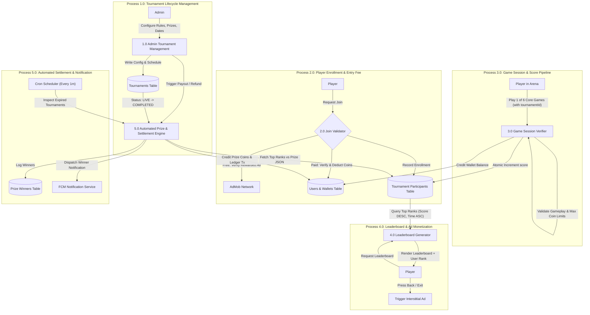
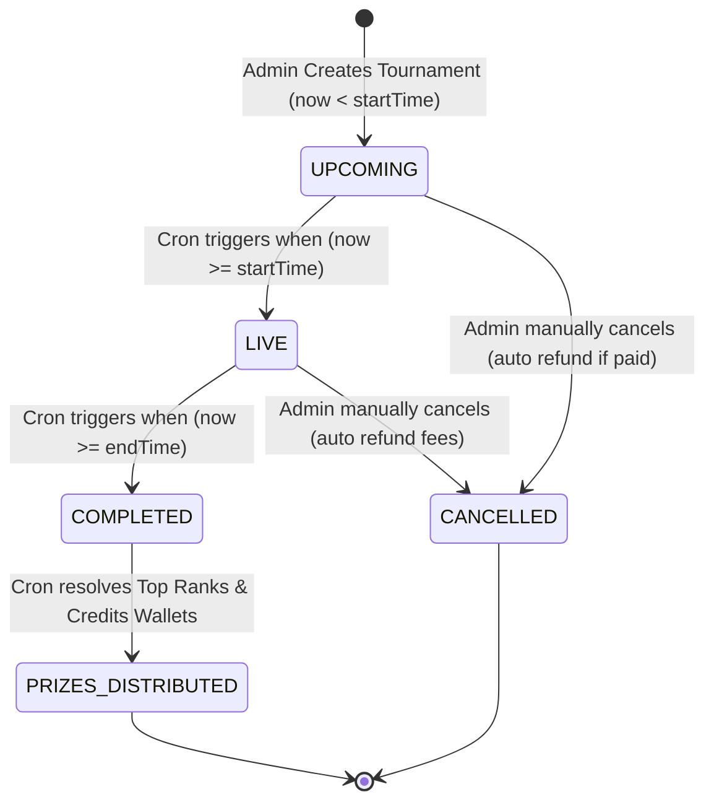
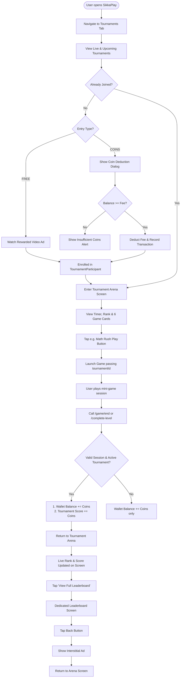
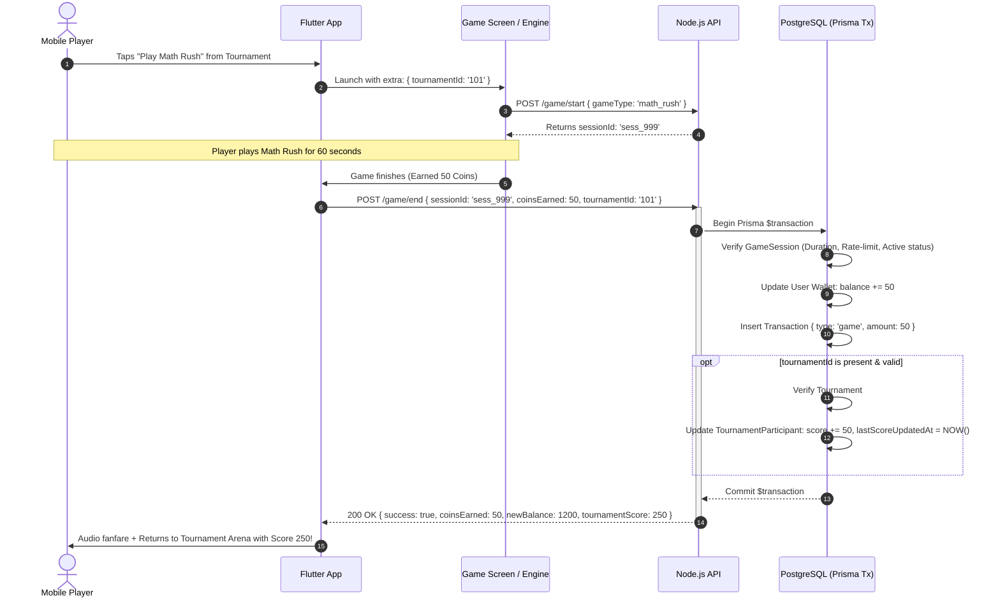
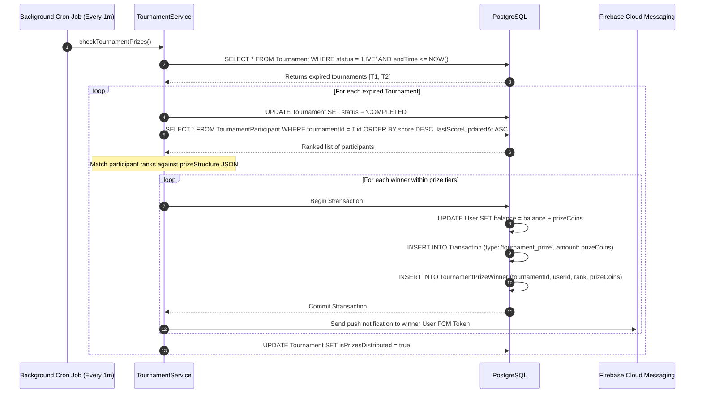

# SikkaPlay Tournaments System: Master Architecture & Engineering Specification

> **Version:** 1.0  
> **Status:** Finalized Specification  
> **Target Platforms:** Flutter Mobile App (Android/iOS), React Vite Admin Dashboard, Node.js + Express + Prisma + PostgreSQL Backend  
> **Document Purpose:** Complete A-to-Z Technical Architecture, Data Flow Diagrams (DFD), UI/UX Specifications, Monetization Strategy, and Database Design for the SikkaPlay Tournaments feature.

---

## Table of Contents
1. [Executive Summary & Core Rules](#1-executive-summary--core-rules)
2. [Data Flow Diagrams (DFD Level 0 & Level 1)](#2-data-flow-diagrams-dfd)
3. [System Architecture & State Flowcharts](#3-system-architecture--state-flowcharts)
4. [Sequence Diagrams (End-to-End Execution)](#4-sequence-diagrams)
5. [Database Schema & Data Models](#5-database-schema--data-models)
6. [API Specifications (REST Endpoints)](#6-api-specifications)
7. [Flutter Mobile App UI/UX Inventory](#7-flutter-mobile-app-uiux-inventory)
8. [Admin Panel Dashboard & Dynamic Controls](#8-admin-panel-dashboard--controls)
9. [Monetization & AdMob Placement Architecture](#9-monetization--admob-placement)
10. [Implementation Roadmap](#10-implementation-roadmap)

---

## 1. Executive Summary & Core Rules

### 1.1 Overview
The SikkaPlay Tournaments system transforms the casual gaming experience into an asynchronous, time-based **Coin Grinder Tournament**. Instead of restricting players to a single repetitive mini-game, users can play any of the **6 core casual games** to grind coins, where **1 Coin Earned = 1 Tournament Point**.

### 1.2 Eligible Games (Only 6 Games)
Coins earned from gameplay in only these 6 games increment the tournament score:
1. **Treasure Grid** (`treasure_grid`)
2. **Emoji Memory / Memory Flip** (`emoji_memory`)
3. **Math Rush** (`math_rush`)
4. **Colour Sort / Water Sort** (`water_sort`)
5. **Bubble Sort / Bubble Shooter** (`bubble_shooter`)
6. **Arrow Escape** (`arrow_escape`)

### 1.3 Excluded Rewards (0 Tournament Points)
To maintain integrity and fair play, all non-game earnings are strictly filtered out:
- Daily Check-in / Daily Streak
- Daily Promo Codes / Redeem Codes
- External Offerwalls & App Installs (Adscalx, Adscend, Tapjoy)
- Surveys (BitLabs, CPX Research)
- Social Tasks, Visit Links, Spin Wheel Rewards

### 1.4 Tie-Breaker Algorithm
When two or more players accumulate the exact same score:
$$\text{Rank Priority} = \text{Score (DESC)} \longrightarrow \text{lastScoreUpdatedAt (ASC)}$$
*(The player who reached the score first holds the higher rank).*

### 1.5 Scheduled Recurring Templates
1. **1-Hour Flash Rush (3 Times Daily):**
   - Morning: `09:00 AM – 10:00 AM IST`
   - Evening: `06:00 PM – 07:00 PM IST`
   - Night: `10:00 PM – 11:00 PM IST`
2. **Daily Mega Cup:** Every day (`00:00 to 23:59 IST`).
3. **Weekend Special:** Saturday `00:00` to Sunday `23:59 IST`.
4. **Weekly Championship:** Monday `00:00` to Sunday `23:59 IST`.
5. **Monthly Mega League:** 1st of month to final day of month.

---

## 2. Data Flow Diagrams (DFD)

### 2.1 DFD Level 0 (Context Diagram)
The high-level boundary showing data flows between external entities and the SikkaPlay Tournament Subsystem.

```mermaid
flowchart TD
    Admin["Admin (Web Dashboard)"] -->|"Create/Edit Tournaments, Schedules, Prize Tiers"| System["(0.0) SikkaPlay Tournaments Engine"]
    System -->|"Audit Logs, Live Participant Stats, Leaderboards"| Admin

    Player["Player (Flutter Mobile App)"] -->|"Join Request (Ad Proof / Coin Fee), Game Sessions"| System
    System -->|"Active Tournaments, Game Arena, Leaderboard, Prizes"| Player

    AdMob["AdMob / Ad Network"] -->|"Rewarded Ad SSV, Interstitial Impression"| System
    System -->|"Ad Request & Display Callbacks"| AdMob

    FCM["Firebase Cloud Messaging (FCM)"] <--"Push Notifications (Winner Alerts, Start Alerts)"-- System
    
    DB[("PostgreSQL Database")] <-->|"Tournaments, Scores, Wallets, Transactions"| System
```

---

### 2.2 DFD Level 1 (Detailed Subsystem Processes)
Decomposing the tournament system into 5 primary operational processes.



---

## 3. System Architecture & State Flowcharts

### 3.1 State Diagram: Tournament Lifecycle


### 3.2 Flowchart: Player Gameplay & Multi-Tournament Isolation Flow


---

## 4. Sequence Diagrams

### 4.1 Sequence Diagram: Game Completion & Score Update


---

### 4.2 Sequence Diagram: Automated Prize Payout via Cron


---

## 5. Database Schema & Data Models

### 5.1 Prisma Schema Specification

```prisma
enum TournamentStatus {
  UPCOMING
  LIVE
  COMPLETED
  CANCELLED
}

enum TournamentEntryType {
  FREE    // Rewarded Ad entry
  COINS   // Coin entry fee deduction
}

model Tournament {
  id                  String               @id @default(uuid())
  title               String               // e.g., "1-Hour Flash Rush"
  description         String?              // Tournament guidelines & description
  bannerUrl           String?              // Promotional banner image
  tag                 String?              // e.g. "HOT", "FLASH", "MEGA", "WEEKEND"
  
  entryType           TournamentEntryType  @default(FREE)
  entryFee            Int                  @default(0) // 0 for FREE, > 0 for COINS
  maxParticipants     Int?                 // null = Unlimited
  
  allowedGames        String[]             @default(["treasure_grid", "emoji_memory", "math_rush", "water_sort", "bubble_shooter", "arrow_escape"])
  scoreMultiplier     Float                @default(1.0) // 1.0 standard, 2.0 for Happy Hour
  
  prizePool           Int                  @default(0)
  prizeStructure      Json                 // [{"rankMin": 1, "rankMax": 1, "prize": 1500}, {"rankMin": 2, "rankMax": 2, "prize": 800}, ...]
  
  startTime           DateTime
  endTime             DateTime
  status              TournamentStatus     @default(UPCOMING)
  isPrizesDistributed Boolean              @default(false)
  
  isRecurring         Boolean              @default(false)
  recurringCron       String?              // e.g., "0 9,18,22 * * *" for 3x daily flash
  
  createdAt           DateTime             @default(now())
  updatedAt           DateTime             @updatedAt

  participants        TournamentParticipant[]
  prizesAwarded       TournamentPrizeWinner[]

  @@index([status, startTime, endTime])
}

model TournamentParticipant {
  id                 String      @id @default(uuid())
  tournamentId       String
  userId             String
  score              Int         @default(0)
  joinedAt           DateTime    @default(now())
  lastScoreUpdatedAt DateTime    @default(now()) // Tie-breaker timestamp

  tournament         Tournament  @relation(fields: [tournamentId], references: [id], onDelete: Cascade)
  user               User        @relation(fields: [userId], references: [id], onDelete: Cascade)

  @@unique([tournamentId, userId])
  @@index([tournamentId, score(sort: Desc), lastScoreUpdatedAt(sort: Asc)])
}

model TournamentPrizeWinner {
  id            String      @id @default(uuid())
  tournamentId  String
  userId        String
  rank          Int
  score         Int
  prizeCoins    Int
  distributedAt DateTime    @default(now())

  tournament    Tournament  @relation(fields: [tournamentId], references: [id], onDelete: Cascade)
  user          User        @relation(fields: [userId], references: [id], onDelete: Cascade)

  @@unique([tournamentId, userId])
}
```

---

## 6. API Specifications

### 6.1 Public & Authenticated Player APIs

#### `GET /api/v1/tournaments`
- **Auth:** Bearer JWT
- **Query Params:** `tab`: `live` | `upcoming` | `my` | `history`
- **Response:**
```json
{
  "success": true,
  "tournaments": [
    {
      "id": "t-101",
      "title": "1-Hour Flash Rush (Evening)",
      "tag": "FLASH ⚡",
      "bannerUrl": "https://assets.sikkaplay.com/banners/flash.webp",
      "entryType": "FREE",
      "entryFee": 0,
      "prizePool": 2500,
      "startTime": "2026-10-10T18:00:00.000Z",
      "endTime": "2026-10-10T19:00:00.000Z",
      "status": "LIVE",
      "participantCount": 184,
      "isJoined": true,
      "userScore": 120,
      "userRank": 6
    }
  ]
}
```

#### `GET /api/v1/tournaments/:id`
- **Auth:** Bearer JWT
- **Returns:** Detailed tournament model, allowed games list, user enrollment status, top 3 podium preview, and prize tiers.

#### `POST /api/v1/tournaments/:id/join`
- **Auth:** Bearer JWT
- **Body:** `{ "adWatched": true }` (if FREE) or `{}` (if COINS)
- **Logic:**
  - If FREE: Verify `adWatched`, enroll user with `entryFee = 0`.
  - If COINS: Check user `balance >= entryFee`. Deduct fee, write ledger transaction, enroll user.

#### `GET /api/v1/tournaments/:id/leaderboard`
- **Auth:** Bearer JWT
- **Query Params:** `page=1&limit=50`
- **Returns:** Full sorted leaderboard list + Current User's pinned exact rank & score.

---

### 6.2 Admin Control APIs (`/api/v1/admin/tournaments`)

| Method | Endpoint | Description |
|---|---|---|
| `GET` | `/admin/tournaments` | List all tournaments with filters (status, date range, search) |
| `POST` | `/admin/tournaments` | Create new tournament with custom dynamic prize tiers & game list |
| `PUT` | `/admin/tournaments/:id` | Update tournament metadata, banner, status, or prizes |
| `POST` | `/admin/tournaments/:id/duplicate` | Clone existing tournament configuration for quick rescheduling |
| `POST` | `/admin/tournaments/:id/payout` | Force manual prize distribution trigger |
| `POST` | `/admin/tournaments/:id/cancel` | Cancel tournament and auto-refund entry coins to all participants |

---

## 7. Flutter Mobile App UI/UX Inventory

### 7.1 Screen 1: Tournaments Hub (`/tournaments`)
```
┌──────────────────────────────────────────────┐
│  🏆 Tournaments                🪙 1,250      │
├──────────────────────────────────────────────┤
│ [ 🔴 Live (2) ] [ Upcoming ] [ My (1) ] [Past]│
├──────────────────────────────────────────────┤
│ ┌──────────────────────────────────────────┐ │
│ │ ⚡ FLASH RUSH (EVENING)        [LIVE NOW]│ │
│ │ ⏱️ Ends in: 34m 12s   💰 Pool: 2,500 🪙   │ │
│ │ 👥 184 Players        🎟️ FREE (Ad)       │ │
│ │                                          │ │
│ │ [ ENTER ARENA ➔ ]                        │ │
│ └──────────────────────────────────────────┘ │
│ ┌──────────────────────────────────────────┐ │
│ │ 🏆 DAILY MEGA CUP               [50 🪙]  │ │
│ │ ⏱️ Ends in: 5h 20m    💰 Pool: 10,000 🪙  │ │
│ │ 👥 412 Players        🎟️ COINS ENTRY     │ │
│ │                                          │ │
│ │ [ JOIN NOW (50 🪙) ]                     │ │
│ └──────────────────────────────────────────┘ │
└──────────────────────────────────────────────┘
```

---

### 7.2 Screen 2: Tournament Detail & Game Arena (`/tournaments/:id`)
```
┌──────────────────────────────────────────────┐
│  ← ⚡ 1-Hour Flash Rush        ⏱️ 34m 12s   │
├──────────────────────────────────────────────┤
│ ┌──────────────────────────────────────────┐ │
│ │ 👤 YOUR CURRENT STANDING                 │ │
│ │ Points: 150 Pts          Rank: #4 / 184  │ │
│ │ Winning Zone: Top 10     Prize: 200 🪙   │ │
│ └──────────────────────────────────────────┘ │
├──────────────────────────────────────────────┤
│ 🏆 [ VIEW FULL LEADERBOARD & PRIZES ➔ ]      │
├──────────────────────────────────────────────┤
│ 🎮 PLAY GAMES TO EARN POINTS                 │
│ ┌──────────────┐          ┌──────────────┐   │
│ │ 💣 Treasure  │          │ ⚡ Math Rush │   │
│ │    Grid      │          │              │   │
│ │   [ PLAY ]   │          │   [ PLAY ]   │   │
│ └──────────────┘          └──────────────┘   │
│ ┌──────────────┐          ┌──────────────┐   │
│ │ 🧠 Emoji     │          │ 🏹 Arrow     │   │
│ │    Memory    │          │    Escape    │   │
│ │   [ PLAY ]   │          │   [ PLAY ]   │   │
│ └──────────────┘          └──────────────┘   │
│ ┌──────────────┐          ┌──────────────┐   │
│ │ 🫧 Bubble    │          │ 🧪 Colour    │   │
│ │    Sort      │          │    Sort      │   │
│ │   [ PLAY ]   │          │   [ PLAY ]   │   │
│ └──────────────┘          └──────────────┘   │
└──────────────────────────────────────────────┘
```

---

### 7.3 Screen 3: Dedicated Leaderboard Screen (`/tournaments/:id/leaderboard`)
```
┌──────────────────────────────────────────────┐
│  ← 🏆 Leaderboard                            │
├──────────────────────────────────────────────┤
│                  🥇 Gold                     │
│               Aman_99 (450 Pts)              │
│                Prize: 1,000 🪙               │
│         🥈 Silver             🥉 Bronze      │
│      Rahul_G (380 Pts)     Priya_K (290 Pts) │
│       Prize: 500 🪙          Prize: 300 🪙   │
├──────────────────────────────────────────────┤
│ #4   YOU                   150 Pts    200 🪙 │
│ #5   Karan_V               140 Pts    100 🪙 │
│ #6   Deepak_S              125 Pts    100 🪙 │
│ #7   Rohit_M               110 Pts    100 🪙 │
├──────────────────────────────────────────────┤
│ [STICKY] YOU: Rank #4 | 150 Pts | Prize: 200🪙│
└──────────────────────────────────────────────┘
  ▲ When player taps '← Back', Interstitial Ad triggers!
```

---

## 8. Admin Panel Dashboard & Controls

Located in `admin/src/pages/Tournaments.tsx`:

```
┌─────────────────────────────────────────────────────────────────────────────┐
│ 🏆 Tournaments Manager                         [ + Create Tournament ]      │
├─────────────────────────────────────────────────────────────────────────────┤
│ Search: [_____________]  Filter Status: [ ALL ▾ ]   Type: [ ALL ▾ ]         │
├─────────────────────────────────────────────────────────────────────────────┤
│ Title            Status   Dates             Entry  Prize Pool  Actions      │
│ 1-Hour Flash #1  LIVE     Today 18:00-19:00 FREE   2,500 🪙    [Edit] [View]│
│ Daily Mega Cup   LIVE     Today 00:00-23:59 50 🪙  10,000 🪙   [Edit] [View]│
│ Weekend Cup      UPCOMING Sat 00:00-Sun 23  100 🪙 25,000 🪙   [Edit] [Copy]│
└─────────────────────────────────────────────────────────────────────────────┘
```

### Dynamic Create/Edit Modal Features:
1. **Title & Tags:** Text inputs for Title, Subtitle, Banner URL, Badges.
2. **Scheduling:** Start DateTime & End DateTime Pickers.
3. **Entry Selection:** Toggle `FREE (Rewarded Ad)` vs `COINS (Input Fee)`.
4. **Allowed Games Selector:** 6 checkboxes for each game.
5. **Dynamic Prize Tiers Builder:**
   - Row 1: Rank `1` to `1` $\rightarrow$ Prize: `1500` Coins
   - Row 2: Rank `2` to `2` $\rightarrow$ Prize: `800` Coins
   - Row 3: Rank `3` to `3` $\rightarrow$ Prize: `400` Coins
   - Row 4: Rank `4` to `10` $\rightarrow$ Prize: `150` Coins each
   - `[ + Add Tier Row ]` button.
6. **Multipliers:** 1.0x default, or set 2.0x for promotional events.

---

## 9. Monetization & AdMob Placement

### 9.1 High-Value Touchpoints:
1. **Entry Touchpoint (Rewarded Video Ad):**
   - Every participant in a **FREE** tournament watches 1 full Rewarded Ad to enroll.
   - High eCPM ($2 to $5+ in Tier 1/2 geos, solid return in India).
2. **Leaderboard Exit Touchpoint (Interstitial Ad):**
   - Players obsessively check rankings after every match.
   - Back action triggers `AdService.instance.showInterstitialAd(...)`.
   - **Protection Rule:** 30–45 seconds cooldown timer prevents ad spam and ensures AdMob policy compliance.
3. **Paid Entry Coin Sink:**
   - 50–100 coins entry fee directly deflates the in-app economy and drives engagement towards high-value tasks.

---

## 10. Implementation Roadmap

| Phase | Milestone | Deliverables |
|---|---|---|
| **Phase 1** | **Database & Models** | Update `schema.prisma` with `Tournament`, `TournamentParticipant`, `TournamentPrizeWinner`. Run `prisma db push`. |
| **Phase 2** | **Backend APIs & Services** | Implement `tournament.service.ts`, `tournament.controller.ts`, `tournament.routes.ts`. |
| **Phase 3** | **Game Score Hookup** | Integrate `tournamentId` validation and score increments into `game.controller.ts`, `arrowEscape.controller.ts`, `waterSort.controller.ts`, `bubbleShooter.controller.ts`. |
| **Phase 4** | **Cron Automation** | Background runner for status transitions (Upcoming $\rightarrow$ Live $\rightarrow$ Completed) and automatic wallet prize distribution. |
| **Phase 5** | **Admin Dashboard** | Build React/Vite `Tournaments.tsx` screen with Dynamic Prize Tiers Builder and actions. |
| **Phase 6** | **Flutter Mobile Client** | Implement Tournaments Hub, Detail/Arena, Dedicated Leaderboard, Join Modals, and Interstitial Ad triggers. |
| **Phase 7** | **End-to-End Verification** | Full staging test: Admin creates tournament $\rightarrow$ User joins $\rightarrow$ Games played $\rightarrow$ Score incremented $\rightarrow$ Leaderboard checked $\rightarrow$ Prize distributed. |
